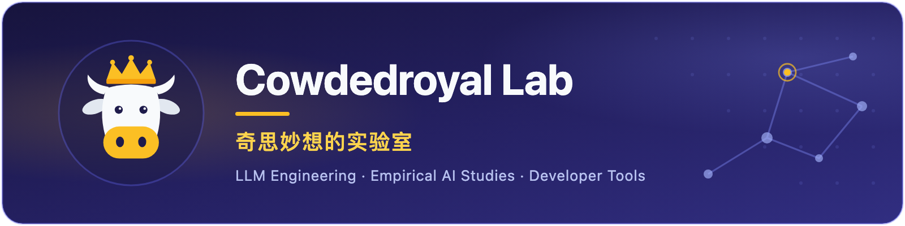

 

---

## 关于

这里是 **Cowdedroyal Lab（奇思妙想的实验室）**——放着我在 **AI / 大模型工程** 方向的实证实验、顺手的 **开发者工具**，以及过去积累的课程与折腾记录。

每个自研仓库都会尽量写清 **问题 → 方案 → 结果与局限**，并在仓库中给出可复现脚本或 `.portfolio/project.yaml` 证据清单。

## 精选项目

| 项目 | 简介 | 关键词 |
| --- | --- | --- |
| [**langgraph-agentic-workflow**](https://github.com/cowdedroyal-lab/langgraph-agentic-workflow) | 多跳问答证据访问路径实证研究与成本模型：在 3 万到 300 万字合成金融语料上，对比长上下文、RAG、物化视图、Agent 七条路径及 KV Cache 压缩的准确率、成本与延迟分界点（含早期 LangGraph 自纠错 RAG） | `Long Context` · `RAG` · `Agentic Search` · `Text-to-SQL` · `KV Cache` · `LangGraph` |
| [**context-studio**](https://github.com/cowdedroyal-lab/context-studio) | 上下文工作台：VS Code / Cursor 扩展，实时跟随当前 Claude Code / Codex 会话，展示上下文占用仪表盘、缓存命中与请求趋势，支持本机与 Remote SSH | `VS Code` · `Cursor` · `Claude Code` · `Codex` · `Remote SSH` |

## 课程与学习归档

| 项目 | 简介 | 语言 |
| --- | --- | --- |
| [DeepLearningExperience](https://github.com/cowdedroyal-lab/DeepLearningExperience) | 研究生深度学习课程 8 个经典实验：CNN、ViT、LSTM、Transformer 翻译、YOLOv5、SegNet、图像描述 | Python |
| [OSCLASS](https://github.com/cowdedroyal-lab/OSCLASS) | 操作系统课程笔记与实验：进程、POSIX 线程、互斥锁、信号量与经典同步问题 | C |
| [Creative_thinking](https://github.com/cowdedroyal-lab/Creative_thinking) | 研究生《创造性思维》课程复习资料：TRIZ、发散思维、矛盾分析 | Notes |

## 工具与折腾

- [**hub-mirror**](https://github.com/cowdedroyal-lab/hub-mirror) — 用 GitHub Actions 将海外容器镜像同步到国内（fork · Go）
- [**warden-worker**](https://github.com/cowdedroyal-lab/warden-worker) — 运行在 Cloudflare Workers 上的 Bitwarden 兼容服务端（fork · Rust）

## 技术栈

---

如果某个实验或工具对你有帮助，欢迎点个 ⭐，也欢迎在 Issues 里交流想法。

