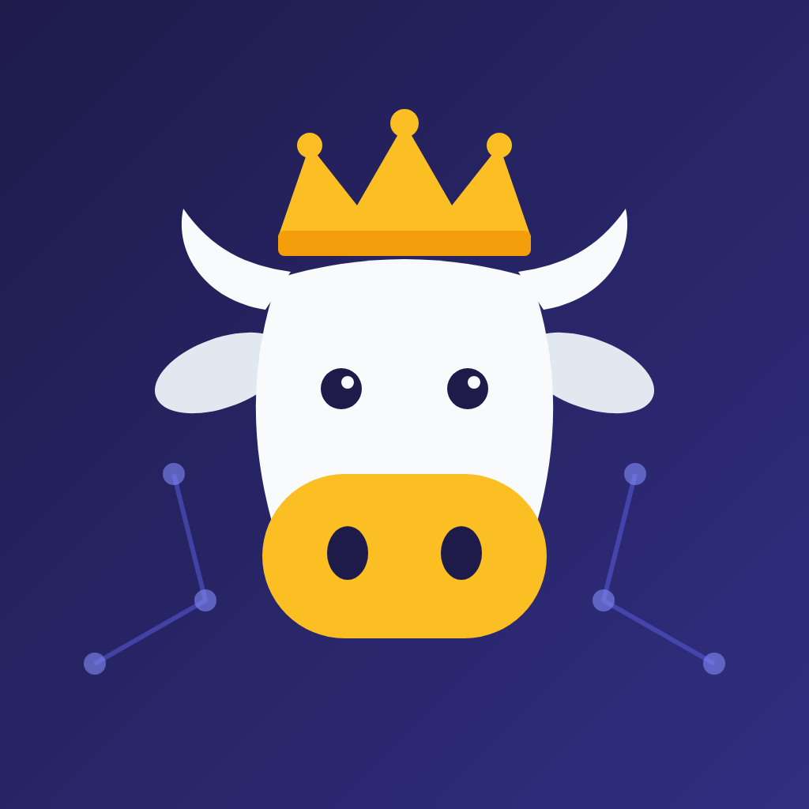

# Cowdedroyal Lab

**LLM 应用与后训练实验室**：Agentic RAG · 混合检索 · LoRA / GRPO / DPO · vLLM 服务化

---

## 关于

这里放的是我在 **大模型应用工程** 方向做的项目与学习记录：怎么检索得更全、怎么让生成可校验、
怎么用评测结果驱动小模型后训练，以及怎么把这些东西部署起来。每个仓库都会写清楚
**问题 → 方案 → 结果**，并在 `.portfolio/project.yaml` 中给出可追溯的证据。

## 精选项目

| 项目 | 简介 | 关键词 |
| --- | --- | --- |
| [**langgraph-agentic-workflow**](https://github.com/cowdedroyal-lab/langgraph-agentic-workflow) | 金融多跳问答 Agentic RAG：自纠错 LangGraph 工作流，评测指标直接复用为 GRPO 奖励，形成“评测 → 训练”闭环 | LangGraph · FAISS+BM25+RRF · LoRA · GRPO · vLLM · Ray |
| [**ecommerce-rag-assistant**](https://github.com/cowdedroyal-lab/ecommerce-rag-assistant) | 中文电商客服 RAG：混合检索 + 精排 + 小模型生成，用分层评测检验 SFT / DPO 小模型在哪些场景真的能替代 base | FastAPI · Vue 3 · Cross-Encoder · SFT · DPO |

## 课程与学习归档

| 项目 | 简介 |
| --- | --- |
| [DeepLearningExperience](https://github.com/cowdedroyal-lab/DeepLearningExperience) | 研究生深度学习课程 8 个实验：CNN、ViT、LSTM、Transformer 翻译、YOLOv5、SegNet、图像描述 |
| [OSCLASS](https://github.com/cowdedroyal-lab/OSCLASS) | 操作系统课程笔记与实验：进程、POSIX 线程、互斥锁、信号量与经典同步问题 |
| [Creative_thinking](https://github.com/cowdedroyal-lab/Creative_thinking) | 研究生《创造性思维》课程复习资料：TRIZ、发散思维、矛盾分析 |

## 工具与折腾

- [hub-mirror](https://github.com/cowdedroyal-lab/hub-mirror)：用 GitHub Actions 把海外容器镜像同步到国内（fork）
- [warden-worker](https://github.com/cowdedroyal-lab/warden-worker)：运行在 Cloudflare Workers 上的 Bitwarden 兼容服务端（fork）

## 技术栈

---

如果某个项目对你有帮助，欢迎点个 ⭐，也欢迎在 Issues 里交流。

